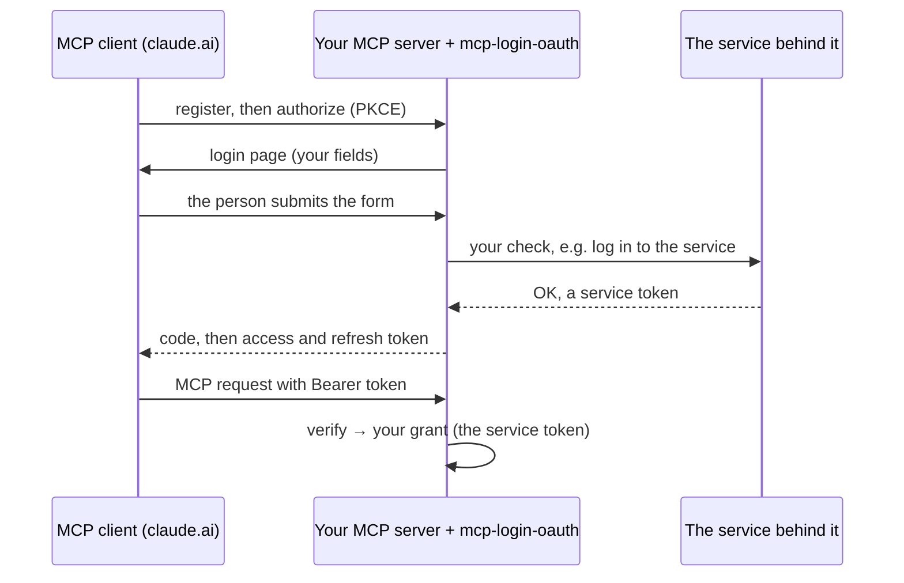

---
hide:
  - toc
---

# Sign-in for MCP servers behind a login form

For FastMCP servers in front of another service. claude.ai and the Claude apps sign in once through your server's own login (a Trilium password, a Paperless login) and then only hold OAuth tokens. Your server turns each login into a grant and reads it back on every request.

[Get started](getting-started.md){ .md-button .md-button--primary }
[Reference](reference.md){ .md-button }

!!! tip "Building in TypeScript?"
    This library is Python only. TypeScript apps, with or without an MCP endpoint, sign in with Better Auth: see [TypeScript: use Better Auth](typescript.md).

## How it works

Your code supplies the login fields and the check that turns a submitted form into a grant. The library does the rest:

- discovery (RFC 8414, RFC 9728), dynamic client registration (RFC 7591), PKCE `S256`, rotating refresh tokens;
- revocation (RFC 7009), also for public clients like claude.ai;
- tokens bound to a resource (RFC 8707) and the issuer on the code redirect (RFC 9207);
- an encrypted store that survives restarts: a code or refresh token works once, also after a restart;
- the login page and honest dead-end pages for broken flows;
- protection against password guessing.

Every lifetime and refusal is on [Behaviour](behaviour.md).

## Used by

[trilium-mcp](https://github.com/Marceltov/trilium-mcp), [invoiceninja-mcp](https://github.com/Marceltov/invoiceninja-mcp), [paperless-ngx-mcp](https://github.com/Marceltov/paperless-ngx-mcp) and the recall engine in [trilium-llm-wiki](https://github.com/Marceltov/trilium-llm-wiki).

## License

Copyright © 2026 Marcel Bruckner. Licensed under the [GNU Affero General Public License v3.0 or later](https://github.com/Marceltov/mcp-login-oauth/blob/main/LICENSE).
