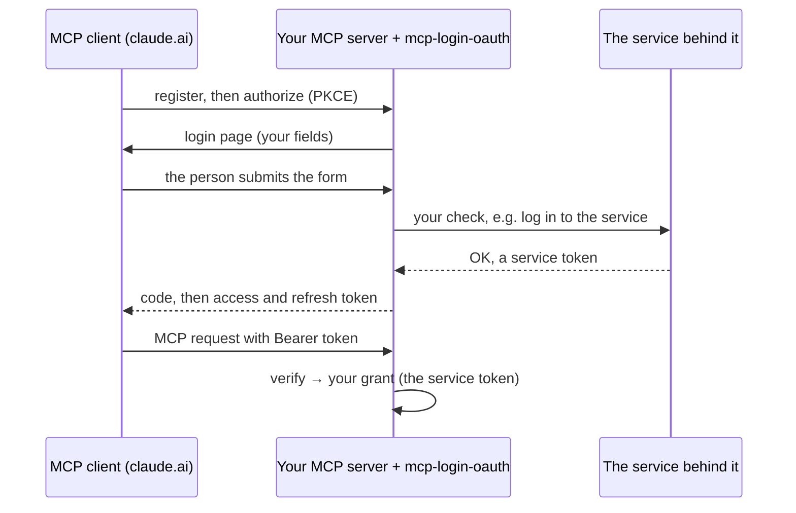

# mcp-login-oauth

The OAuth 2.1 server that MCP clients such as claude.ai and the Claude desktop and mobile apps connect through, for **MCP servers whose login is a form checked by the service behind them**: a Trilium password, an InvoiceNinja or Paperless login. The client signs in once in the browser and then only holds opaque OAuth tokens; your server turns each login into a *grant*, for example a service token minted at login, and reads it back on every request.

It comes as a [Python package](getting-started/python.md) for FastMCP servers and a [TypeScript package](getting-started/typescript.md) for MCP servers on Node.js, with the same behaviour.

## Is this the right library?

| You are building … | Use |
|---|---|
| An MCP server in front of another service, where people sign in with that service's own login | **mcp-login-oauth** |
| An MCP server without its own users, where people sign in at one OpenID Connect provider (TypeScript) | **mcp-login-oauth**, with an `oidc` login |
| An app with a web UI and its own users (accounts, sessions, magic links, passkeys, several providers), with or without an MCP endpoint | **[Better Auth](https://better-auth.com)**, with `@better-auth/mcp` for MCP clients |

This library deliberately holds no user accounts or sessions ([V7](values.md#v7-a-login-library-not-an-account-system), [ADR 0004](adr/0004-web-apps-sign-in-with-better-auth.md)).

## How it works

Your code supplies the login fields and the check that turns a submitted form into a grant. The library does the rest:

- discovery (RFC 8414, RFC 9728), dynamic client registration (RFC 7591), PKCE `S256`, rotating refresh tokens;
- revocation (RFC 7009), also for public clients like claude.ai;
- tokens bound to a resource (RFC 8707) and the issuer on the code redirect (RFC 9207);
- an encrypted store that survives restarts: a code or refresh token works once, also after a restart;
- the login page and honest dead-end pages for broken flows;
- protection against password guessing.

What both packages do in detail, with every lifetime and refusal, is on [Behaviour](reference/behaviour.md).

## Used by

[trilium-mcp](https://github.com/Marceltov/trilium-mcp), [invoiceninja-mcp](https://github.com/Marceltov/invoiceninja-mcp), [paperless-ngx-mcp](https://github.com/Marceltov/paperless-ngx-mcp) and the recall engine in [trilium-llm-wiki](https://github.com/Marceltov/trilium-llm-wiki).

## License

Copyright © 2026 Marcel Bruckner. Licensed under the [GNU Affero General Public License v3.0 or later](https://github.com/Marceltov/mcp-login-oauth/blob/main/LICENSE).
