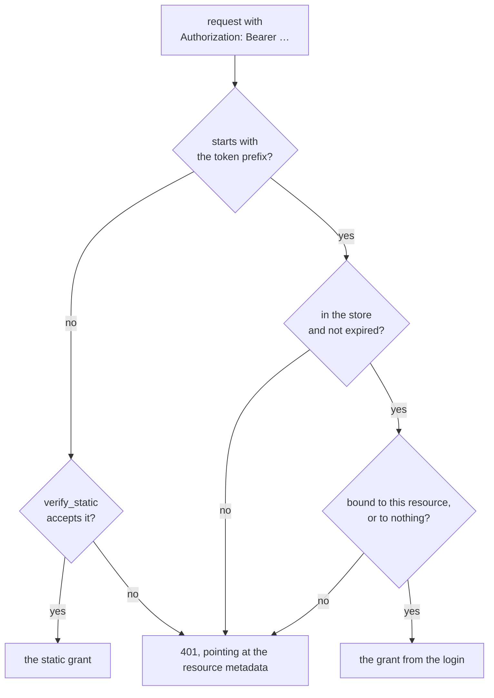

# Behaviour

What both packages do, the same in Python and TypeScript ([V3](../values.md#v3-the-same-in-python-and-typescript)).

## Lifetimes and limits

| | Python | TypeScript | Default |
|---|---|---|---|
| Login link (the pending authorize) | `pending_ttl` | `ttl.pending` | 600 s |
| Authorization code | `code_ttl` | `ttl.code` | 300 s |
| Access token | `access_ttl` | `ttl.access` | 3600 s |
| Refresh token, rotated on every use | `refresh_ttl` | `ttl.refresh` | 30 days |
| Delay after a refused login | `failed_login_delay` | `failedLoginDelayMs` | 1 s |
| Refused logins before a login link ends | `max_login_attempts` | `maxLoginAttempts` | 5 |

## The flow

- **Discovery:** authorization server metadata (RFC 8414) and protected resource metadata (RFC 9728). The metadata advertises `authorization_response_iss_parameter_supported`.
- **Registration:** dynamic client registration (RFC 7591), open to any client.
- **Authorize:** PKCE `S256` only. The code redirect carries `iss` (RFC 9207).
- **Token:** a code works once; a refresh token works once and returns a new pair. Both stay spent across a restart, because the store deletes them as it reads them.
- **Revocation** (RFC 7009) works for public clients like claude.ai too, which the MCP SDK's own `/revoke` rejects. `on_revoke` / `onRevoke` runs for the revoked grant.

## Resources

Every request ends in a grant or in a 401 that tells the client where to sign in.

A client that names a `resource` (RFC 8707) gets codes and tokens bound to it. A token bound to anything other than the MCP endpoint (or, in TypeScript, one of `resources`) is refused, and so is its refresh; this also signs clients out when the base URL changes. A client that names no resource gets a token that counts as bound to the MCP endpoint.

## What is stored, and what never is

- **The store is its own file**, next to the server's data, not in it. Losing it only makes connected clients sign in again.
- **Everything in it is encrypted** with a key derived from the server's secret (Fernet in Python, AES-256-GCM with HMAC keys in TypeScript). Changing the secret signs every client out.
- **A form is never stored or logged.** Only the grant is stored. Logs never carry a form, a token or a person's details.

## Protection

- After a refused login the page waits, and a login link ends after 5 refusals or 10 minutes.
- **A POST to the login page must come from the page itself** (`Origin`, `Sec-Fetch-Site`): an auto-submitting form on another site can't sign a person in for a client they never saw.
- **The OIDC sign-in** (TypeScript) is bound to the browser that started it by a cookie. The id_token's issuer, audience, `azp`, expiry and nonce are checked; its signature isn't, because it comes straight from the token endpoint over TLS, which OIDC Core 3.1.3.7 allows.

## Moving to this library

A server that moves here from its own OAuth code doesn't carry its stored logins over: connected clients sign in once more.
