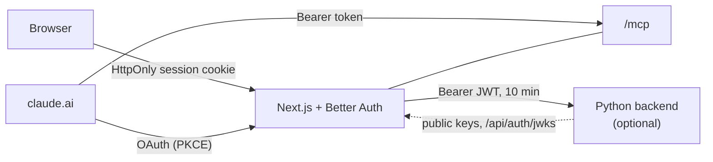

# Coming from TypeScript

**mcp-login-oauth is Python only. A TypeScript app, with or without an MCP endpoint, signs in with [Better Auth](https://better-auth.com).** This page says why, how the pieces fit, and how to wire it up in a Next.js app.

## Why Better Auth

- **It already does what a TypeScript app needs:** accounts, sessions, magic links and email codes, passkeys, any OpenID Connect provider (authentik, Authelia, Google, Apple, …), and an OAuth server for MCP clients (`@better-auth/mcp`) with tokens bound to a resource, rotating refresh tokens, revocation and Client ID Metadata Documents.
- **Sign-in is security code.** Rebuilding all of that next to this library would be a second, smaller copy of something maintained and used widely. This library stays small: the OAuth server for FastMCP servers whose login is a form checked by the service behind them.
- **It runs in your app**, an open-source (MIT) library in the app's process, with its tables in your own database. Nothing goes to a third party; its telemetry is off unless you turn it on.

When is this library still the right one? When the MCP server is Python (FastMCP) and the login is another service's own, so that the grant carries that service's credentials: see [Install and first server](getting-started.md).

## How the pieces fit



The sign-in lives in the Next.js app; everything behind it only checks tokens.

- **The web UI uses a backend-for-frontend (BFF).** The browser holds only Better Auth's `HttpOnly` session cookie and talks only to Next.js. When a separate backend exists, a Next.js route forwards the request and adds a short-lived JWT for the signed-in user. No token ever reaches the browser's JavaScript, and there is no CORS. Next.js and the backend still deploy and scale apart.
- **MCP clients** such as claude.ai sign in through OAuth at the app and call the MCP endpoint with their bearer token. The endpoint can live in Next.js or in Python.
- **A backend never signs anyone in.** It checks each JWT against the app's public keys (signature, issuer, audience, expiry), takes the user id from it, and refuses any request without one, also from inside the network. It shares nothing with the app, so it scales behind a load balancer without sticky sessions. A JWT can't be revoked before it expires, so it lives only minutes.

## Wire it up

A sketch for a Next.js app; check the option names against the Better Auth version you install.

```ts
// lib/auth.ts
import Database from "better-sqlite3";
import { betterAuth } from "better-auth";
import { emailOTP, jwt, magicLink } from "better-auth/plugins";
import { passkey } from "@better-auth/passkey";
import { mcp } from "@better-auth/mcp";
import { cimd } from "@better-auth/cimd";
import { fetchClientMetadataResource } from "@better-auth/cimd/node";

const base = process.env.PUBLIC_URL!;

export const auth = betterAuth({
  baseURL: base,
  secret: process.env.APP_SECRET!,                        // your app's own variable, passed in
  database: new Database(`${process.env.DATA_DIR}/auth.sqlite`),  // its own file, next to your data
  plugins: [
    jwt({ jwt: { expirationTime: "10m", audience: `${base}/api/v1` } }),
    mcp({ loginPage: "/sign-in", consentPage: "/consent", resource: `${base}/mcp` }),
    cimd({ fetchClientMetadataResource, metadataProfile: "mcp-2026-07-28" }),
    emailOTP({ storeOTP: "hashed", async sendVerificationOTP({ email, otp }) { /* your SMTP */ } }),
    magicLink({ storeToken: "hashed", async sendMagicLink({ email, url }) { /* your SMTP */ } }),
    passkey(),
  ],
});
```

```ts
// app/api/auth/[...all]/route.ts: Better Auth's own endpoints (sign-in, OAuth, /jwks)
import { toNextJsHandler } from "better-auth/next-js";
import { auth } from "@/lib/auth";
export const { GET, POST } = toNextJsHandler(auth);
```

```ts
// app/mcp/route.ts: the MCP endpoint, for OAuth tokens bound to /mcp
import { requireMcpAuth } from "@better-auth/mcp";
import { auth } from "@/lib/auth";
export const POST = requireMcpAuth(auth, async (request, claims) => {
  const userId = claims.sub;
  // … hand the request to the MCP SDK, scoped to userId
});
```

```ts
// app/api/v1/[...path]/route.ts: the BFF, forwarding to a Python backend
import { auth } from "@/lib/auth";

async function forward(request: Request) {
  const { token } = await auth.api.getToken({ headers: request.headers }); // fails when signed out
  const url = new URL(request.url);
  return fetch(`${process.env.BACKEND_URL}${url.pathname}${url.search}`, {
    method: request.method,
    headers: { authorization: `Bearer ${token}`, "content-type": request.headers.get("content-type") ?? "" },
    body: ["GET", "HEAD"].includes(request.method) ? undefined : await request.arrayBuffer(),
  });
}
export { forward as GET, forward as POST, forward as PUT, forward as DELETE };
```

```python
# The Python backend: check the JWT, take the user id
import ssl, jwt, truststore

jwks = jwt.PyJWKClient(f"{APP_URL}/api/auth/jwks", ssl_context=truststore.SSLContext(ssl.PROTOCOL_TLS_CLIENT))

def user_id(authorization: str) -> str:
    token = authorization.removeprefix("Bearer ")
    key = jwks.get_signing_key_from_jwt(token).key
    claims = jwt.decode(token, key, algorithms=["EdDSA"], audience=f"{APP_URL}/api/v1", issuer=APP_URL)
    return claims["sub"]
```

For an MCP endpoint in Python, FastMCP's `JWTVerifier` with the same keys, issuer and the `/mcp` audience does this.

## Settings that differ from Better Auth's defaults

- **Links and codes hashed:** `storeToken: "hashed"` and `storeOTP: "hashed"`; Better Auth stores them in plain text by default.
- **No `bearer` and no `device-authorization` plugin.** Session tokens are stored in plain text; without the `bearer` plugin, a token copied from the database is useless, because the session cookie must carry a signature made with the secret.
- **During an MCP sign-in, the mail holds only a code, never a link.** A link signs in whichever browser opens it, so someone who started a sign-in with your address could finish it when you click the genuine mail.
- **Telemetry stays off.** Nothing sets `telemetry.enabled` or `BETTER_AUTH_TELEMETRY`.
- **Its own database file**, so backups and exports of your data hold no sessions or tokens.
- **Your own pages:** Better Auth ships none. The app builds its sign-in and consent pages against Better Auth's client.

## More

- [Sign-in](https://marceltov.github.io/engineering-conventions/architecture/sign-in/) and [Better Auth](https://marceltov.github.io/engineering-conventions/stacks/better-auth/) in Marcel's engineering conventions.
- questlog's [ADR 0004](https://github.com/Marceltov/questlog/blob/main/docs/adr/0004-sign-in-with-better-auth.md): a full setup, with every setting and why.
